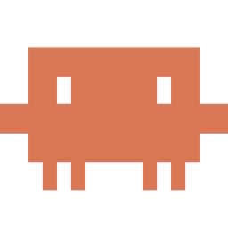
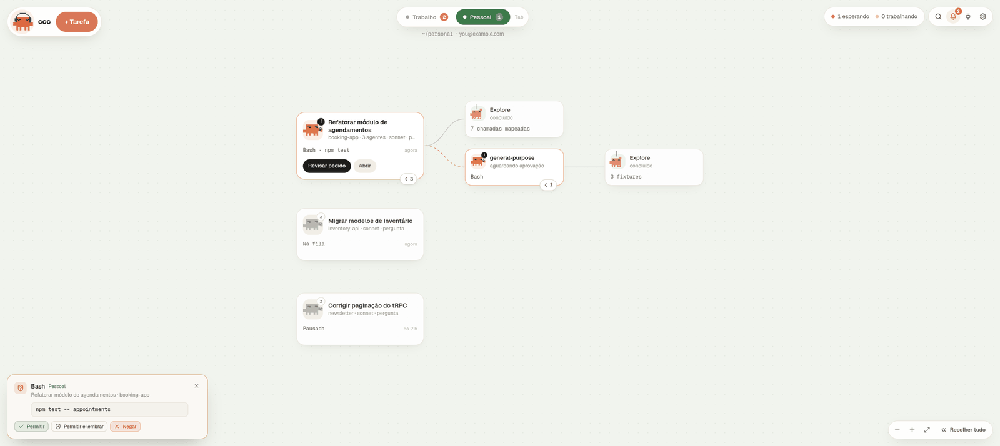
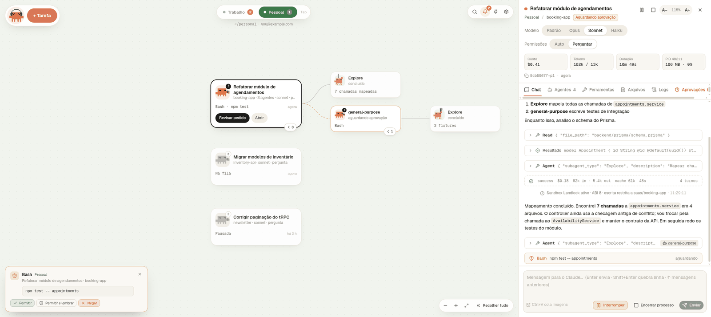
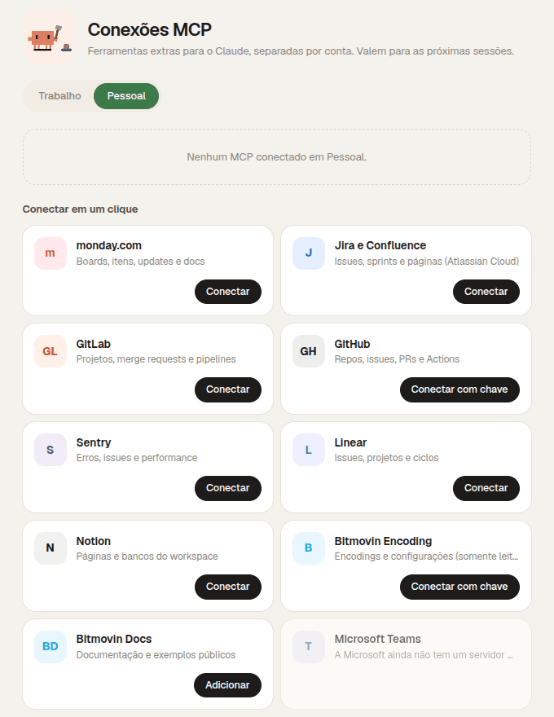

<div align="center">



# ccc

**A calm canvas for your Claude Code sessions.**<br />
Work and personal accounts side by side, never mixed. Every session is a card, every subagent hangs off it, and a little pixel Claude tells you what each one is up to.


<br />



</div>

<br />

## Why

Running a handful of Claude Code sessions in terminals gets messy fast: which one is waiting on you, which one spawned 30 subagents, and which account is it even using? **ccc** puts them all on one board, keeps your work and personal Claude accounts in separate sandboxes, and lets you answer approvals without hunting for the right tab.

## Features

<table>
<tr>
<td width="50%" valign="top">

### 🗺️ Canvas
One card per session, subagents connected to the right. The mascot shows the state at a glance: **typing** while it works, **waiting** while its subagents run, **!** when it needs you, a **flag** when it's done, and a **workout** when nothing is running.

### 🔐 Two accounts, never mixed
Flip between *Trabalho* and *Pessoal* with `Tab`. Each account has its own `CLAUDE_CONFIG_DIR`, workspace, database and Landlock sandbox. The first login links an email to that side; the other side can never use it.

### ✅ Approvals where you are
Allow, deny or "allow and remember" from the card, a toast or the side panel. Switch any session between **Auto** and **Ask** while it runs.

</td>
<td width="50%" valign="top">

### 🌳 Tame big agent trees
Large subtrees fold into a single stack card with per-state counts; finished siblings group together. **Recolher tudo** collapses everything in one click.

### 🧠 Model per task
Pick Opus, Sonnet or Haiku for a new task, or switch mid-session. The **Padrão** option shows which model the account defaults to.

### 💬 A chat that feels like the CLI
Paste screenshots with `Ctrl+V`, recall earlier messages with `↑` / `↓`, jump back to the latest message, and see tools, results, cost and turns inline.

### 🔌 One-click MCP
monday.com, Jira & Confluence, GitLab (self-hosted too), GitHub, Sentry, Linear, Notion, Bitmovin and more, connected per account. OAuth opens in your browser.

</td>
</tr>
</table>

<div align="center">

<br /><sub>The side panel: chat, agents, tools, changed files, logs and approvals. Resizable, with adjustable text size.</sub>
</div>

<br />

<table>
<tr>
<td width="55%" valign="top">

### 📁 Behaviour folder per account
Point each account at a folder with skills (`.claude/skills/*`) and a `CLAUDE.md`. Every session of that account loads them, read-only inside the sandbox. If the folder is a Claude Code plugin (`.claude-plugin/plugin.json`), its agents, commands and hooks load too.

### 🔌 MCP connections
Each account keeps its own MCP servers. Pick one from the catalog, sign in through the browser, done. Servers that need a token (GitHub, Bitmovin) ask for it inline; anything else can be added as a local command or URL.

</td>
<td width="45%" valign="top">

</td>
</tr>
</table>

## Getting started

### Requirements

- Linux with Landlock (kernel 5.13+, ABI 3+ recommended)
- [Claude Code](https://docs.claude.com/en/docs/claude-code) on your `PATH`
- Node 20+, Rust stable and the [Tauri 2 Linux prerequisites](https://v2.tauri.app/start/prerequisites/#linux)

### Build and install

```bash
npm install
npx tauri build --bundles deb
sudo apt install ./src-tauri/target/release/bundle/deb/ccc_0.1.0_amd64.deb
```

### Development

```bash
npm run tauri dev          # full app
npm run dev                # browser preview with mock data, no backend needed
npm test                   # frontend tests
cd src-tauri && cargo test # backend tests, including live sandbox isolation
```

## Connect your accounts

Both accounts start locked. Click **Entrar** on each side and sign in with the Claude account you want there. The first successful login **links** that email to the side; from then on, sessions only start when `claude auth status` reports the same email.

Prefer the terminal?

```bash
CLAUDE_CONFIG_DIR=~/.claude-work     claude auth login
CLAUDE_CONFIG_DIR=~/.claude-personal claude auth login
```

Then open **Configurações** (gear icon) to adjust each account:

| Setting | Default |
|---|---|
| Display name | `Trabalho` / `Pessoal` |
| Workspace (where your repos live) | `~/work` / `~/personal` |
| Config dir (`CLAUDE_CONFIG_DIR`) | `~/.claude-work` / `~/.claude-personal` |
| Expected email | empty until the first login links it |
| Default model | the `model` in the account's `settings.json`, else your plan's default |
| Behaviour folder | none |

The two accounts' workspaces and config dirs must not overlap; ccc refuses any config that would let one side see the other's files. App data lives in `~/.local/share/ccc/` with `0700` / `0600` permissions.

## Keyboard

| Key | Action |
|---|---|
| `Tab` | Switch account (`1` / `2` to pick one) |
| `N` | New task |
| `Ctrl` `K` | Search projects and sessions |
| `Ctrl` `V` | Paste images into a task or chat |
| `↑` / `↓` | Previous / next sent message |
| `Esc` | Close panel |
| `?` | All shortcuts |

## Under the hood

A Tauri 2 shell, a React 19 + React Flow canvas, and a Rust backend that drives `claude` over its stream-JSON protocol. Each session runs in its own actor inside a Landlock sandbox with an allow-listed environment.

- [Architecture](docs/ARCHITECTURE.md)
- [Security and isolation model](docs/SECURITY.md)
- [Claude Code stream protocol notes](docs/PROTOCOL.md)

The UI is in Brazilian Portuguese.

## Credits

- The flag-waving and workout Claude animations are rebuilt from Ayotomiwa Wale-Durojaye's SVG recreation of the Claude mascot ([article](https://tympanus.net/codrops/2026/05/05/reverse-engineering-claude-ais-mascot-animations-with-svg-and-gsap/), [demo](https://ayotomcs.me/claude-mascot)).
- The Claude mascot, name and pixel art belong to Anthropic. ccc is an unofficial community project, not affiliated with or endorsed by Anthropic.
